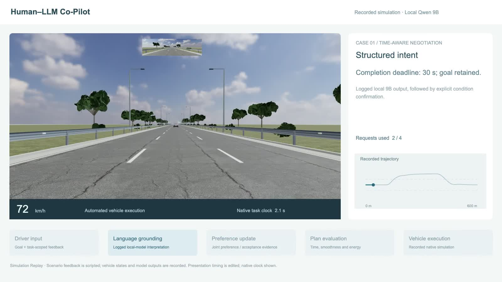
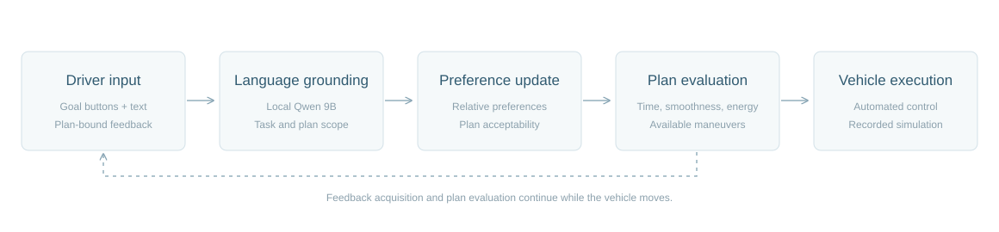

# Human–LLM Co-Pilot

### Language-Guided Shared Decision-Making for Intelligent Vehicles

**[Project page](https://zv-nus.github.io/human-llm-copilot/)** · **[75-second overview](media/human_llm_copilot_demo.mp4)** · **[One-page project brief](media/project_brief.pdf)**

An overtaking request leaves choices about timing, smoothness and energy. This project connects language interpretation, driver feedback, preference updates and automated vehicle execution in a traceable loop.



## Explore the demonstration

The [project page](https://zv-nus.github.io/human-llm-copilot/) works in a browser without model installation. It includes two synchronized first-person/trajectory replays and the associated recorded language and decision events.

1. **Time-aware negotiation:** a 30-second completion requirement is grounded and confirmed. Plan-bound acceptance/reason feedback updates evaluation, followed by a 26-second selected maneuver.
2. **Preference-aware negotiation:** an initial smoothness/energy instruction is followed by acceptance and comparison feedback. The recorded branch selects a 29-second alternative.

The examples replay saved simulation episodes with scripted scenario feedback and logged local Qwen 9B outputs. English captions translate the original Chinese instructions. They illustrate functionality rather than aggregate algorithmic or human-study results. The browser makes no live model calls and does not control a vehicle.

## Interaction loop



**Driver goal/feedback → language grounding → preference and acceptability update → candidate-plan evaluation → automated vehicle execution.**

Goal buttons and plan identities bind language to the current task. Additional feedback takes time while the vehicle continues to move. The recorded implementation evaluates time, smoothness and complete-task energy under its original constraints and request budget.

## Repository scope

This public repository contains the project description, selected derived replay records, presentation renderer and demonstration media. The research implementation is maintained in a separate **private repository**. Raw studies, participant data, private documents, authentication material, model weights and journal PDFs are not part of the public showcase.

For research implementation access, contact [Zhenwu Fang](https://github.com/ZV-NUS).

## View locally

```sh
python3 -m http.server 8080
```

Open `http://127.0.0.1:8080`. The site is static and GitHub Pages compatible.

## Provenance and assets

- [Replay provenance](data/provenance.json): selected episode IDs and presentation-data checksum.
- [Rendering credits](credits.html): vehicle model byｍononofu (CC BY 4.0), Poly Haven surfaces/sky (CC0), and Three.js (MIT).
- Original vehicle states, feedback and logged model outputs are retained in the research archive. Presentation retiming does not alter the native task clock shown in the viewer.

## License

The authored showcase page and presentation code use the MIT license. Third-party models, textures and libraries retain their separate terms. Derived replay data are provided for this recorded demonstration; see provenance for their role.
